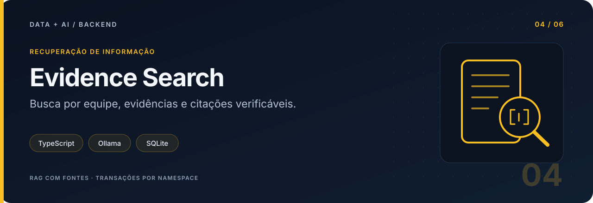
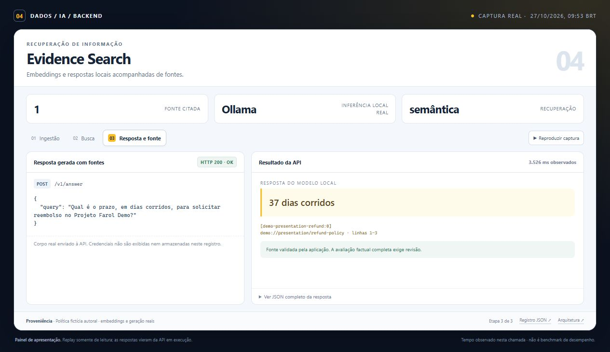
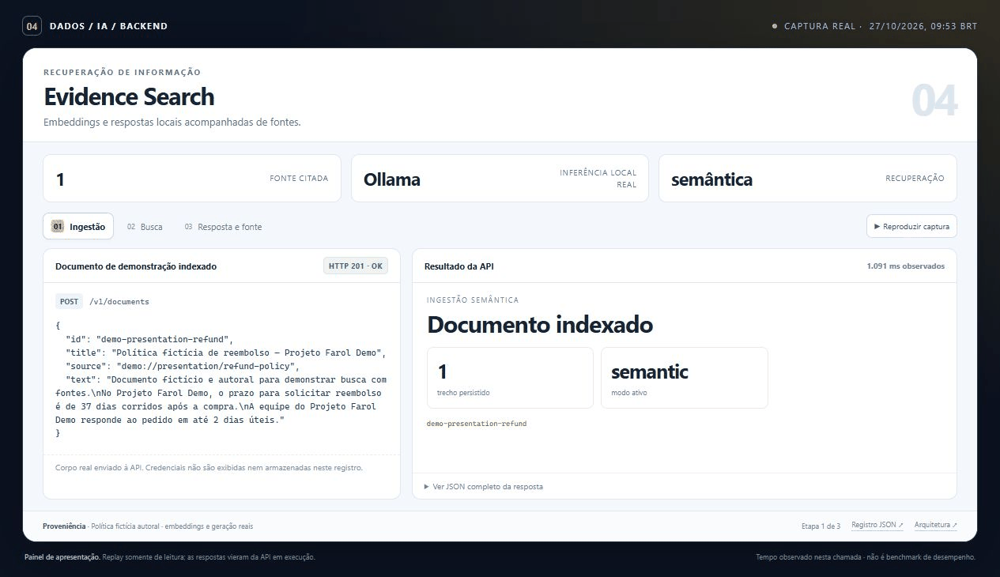
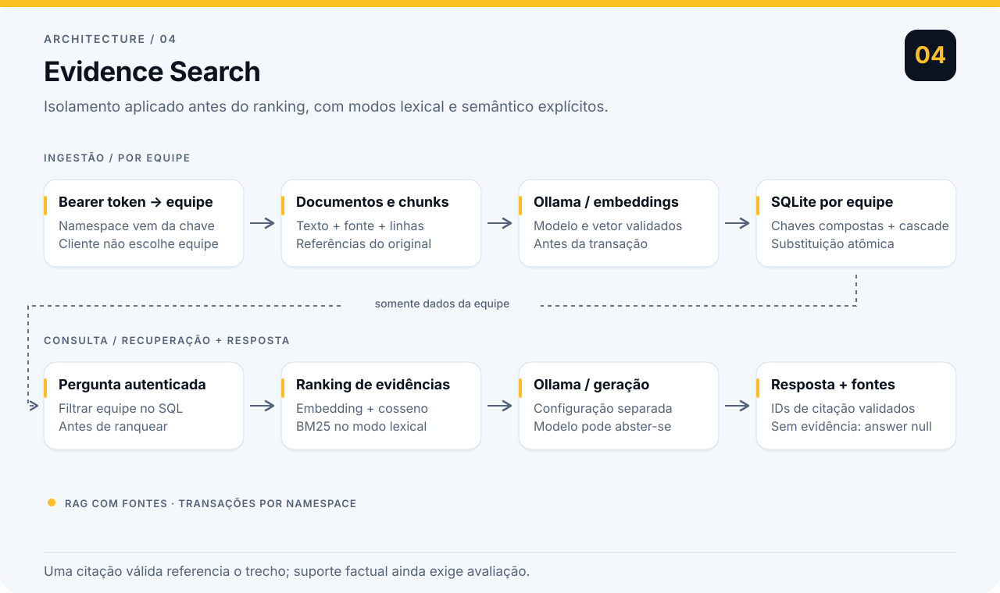

# Evidence Search

Encontra respostas em documentos internos e devolve as evidências utilizadas. A busca respeita o isolamento entre equipes; a geração estruturada exige IDs de fontes válidos e permite abstenção quando falta informação.

**Competência principal:** Recuperação de informação e RAG.

| IA implementada | Backend | Dados da demonstração | Verificação local |
| --- | --- | --- | --- |
| BM25 ou embeddings + geração Ollama | Node.js 24 · TypeScript · SQLite | Documentos fictícios · modelos locais reais | 14 testes aprovados |

[Demonstração e captura](docs/PRESENTATION.md) · [Resultado registrado](reports/ollama-integration.json) · [Plano de commits](COMMITS.txt)

## Demonstração

Painel de demonstração com respostas reais da API. A apresentação organiza requisições, resultados e verificações da execução registrada.

| Captura no navegador | Demonstração animada |
| :---: | :---: |
|  |  |

[Abrir painel local em HTML](docs/demo/index.html) · [Consultar requests, respostas e timestamps](docs/demo/run.json)

Os dados e os limites do cenário estão descritos no [guia da demonstração](docs/PRESENTATION.md). O painel foi preparado para apresentar o backend e suas evidências.

## Arquitetura



Ingestão transacional e recuperação por equipe, com modelos Ollama opcionais e validação das fontes antes da resposta HTTP. Veja as [decisões técnicas](docs/architecture.md).

## Rodar localmente

Requer Node.js 24 ou superior. TypeScript e executado pelo Node sem build; `tsc` faz a verificacao estatica.

```powershell
npm ci
Copy-Item .env.example .env
npm test
npm run typecheck
npm run demo
npm run evaluate
npm start
```

A demo e a avaliacao usam uma base em memoria e nao precisam de `.env`, Ollama ou chave paga. A API usa SQLite em `var/documents.sqlite`. O Node pode emitir um aviso sobre `node:sqlite`.

```powershell
$headers = @{Authorization = 'Bearer demo-team-a'}
$document = @{id='reembolso';title='Reembolso';source='manual.md';text='O pedido de reembolso deve ser enviado em ate 30 dias.'} | ConvertTo-Json
Invoke-RestMethod http://127.0.0.1:8004/v1/documents -Method Post -Headers $headers -ContentType 'application/json' -Body $document
$query = @{query='prazo para reembolso';topK=3} | ConvertTo-Json
Invoke-RestMethod http://127.0.0.1:8004/v1/search -Method Post -Headers $headers -ContentType 'application/json' -Body $query
Invoke-RestMethod http://127.0.0.1:8004/v1/answer -Method Post -Headers $headers -ContentType 'application/json' -Body $query
```

`POST /v1/documents` substitui atomicamente um documento de mesmo id na mesma equipe. `DELETE /v1/documents/{id}` remove tambem os chunks. `GET /health` informa o modo configurado.

## Usar modelos reais

Instale o Ollama separadamente, escolha um modelo de embeddings disponivel e obtenha-o com `ollama pull <modelo>`. Defina `SEARCH_MODE=semantic` e `EMBEDDING_MODEL=<modelo>` no `.env`. O exemplo sugere `embeddinggemma`; o modelo nao vem no repositorio. Reimporte os documentos depois de alterar o modelo. Se quiser respostas geradas, obtenha um modelo de texto e preencha `GENERATION_MODEL`. Sem ele, `/v1/answer` devolve evidencias e `answer: null`.

Para avaliar embeddings, carregue as variaveis explicitamente:

```powershell
node --env-file=.env scripts/evaluate.ts
```

A referencia de integracao e a API oficial do Ollama: `/api/embed` e `/api/generate`. O cliente valida quantidade, dimensao, norma e valores dos vetores e aplica timeout. Os testes usam um servidor HTTP local controlado; nao medem a qualidade de um modelo baixado.

Com os servicos e modelos iniciados, `npm run verify:ollama` valida embeddings, ingestao semantica, isolamento e uma resposta real com citacao. Veja [o procedimento, os requisitos e a falha real que levou a uma correcao](docs/ollama-integration.md). A geracao usa um schema com resposta, IDs de citacao e abstencao, validado novamente pela aplicacao. O adaptador rejeita entradas fora do contexto do modelo em vez de truncar silenciosamente o documento.

A verificacao versionada passou em tres execucoes consecutivas contra o container com Ollama real, usando `embeddinggemma:300m` e `qwen2.5:1.5b`. O [sumario e os registros completos](reports/ollama-integration.json) incluem resposta, fonte e isolamento; a suite isolada tem 14 testes aprovados. As duas falhas encontradas antes da correcao foram preservadas nos relatorios para explicar a decisao tecnica.

## Avaliacao e limites

`data/corpus.json` contem seis documentos ficticios escritos para este projeto; `data/questions.json` contem doze perguntas com documento relevante anotado. `npm run evaluate` salva Recall@3, MRR@3, latencias e casos em `var/evaluation.json`. Um conjunto escrito junto com o corpus e um teste inicial, com vies favoravel; nao prova generalizacao. Amplie com perguntas independentes antes de comparar modelos. A qualidade da geracao nao e medida por esse benchmark.

No modo gerado, citacoes inexistentes sao recusadas. Uma citacao existente nao garante que toda afirmacao esteja apoiada: esse julgamento ainda requer avaliacao humana. Documentos e perguntas sao enviados ao Ollama configurado. Os endpoints nao fazem download de URLs recebidas como `source`.

SQLite e ranking em memoria servem a bases pequenas. Nao ha indice vetorial aproximado, autenticacao por usuario final nem suporte a PDF/OCR. Ha limite de 150 KB por requisicao e 100 mil caracteres de texto. As chaves do exemplo sao publicas, apenas para desenvolvimento local.

## Docker

```powershell
docker build -t evidence-search .
docker run --rm -p 127.0.0.1:8004:8004 --env-file .env -e HOST=0.0.0.0 -v evidence-data:/app/var evidence-search
```

No Docker, `127.0.0.1` e o proprio container. Para Ollama no host, ajuste `OLLAMA_URL` conforme seu ambiente.

Veja [docs/architecture.md](docs/architecture.md) e [COMMITS.txt](COMMITS.txt).
